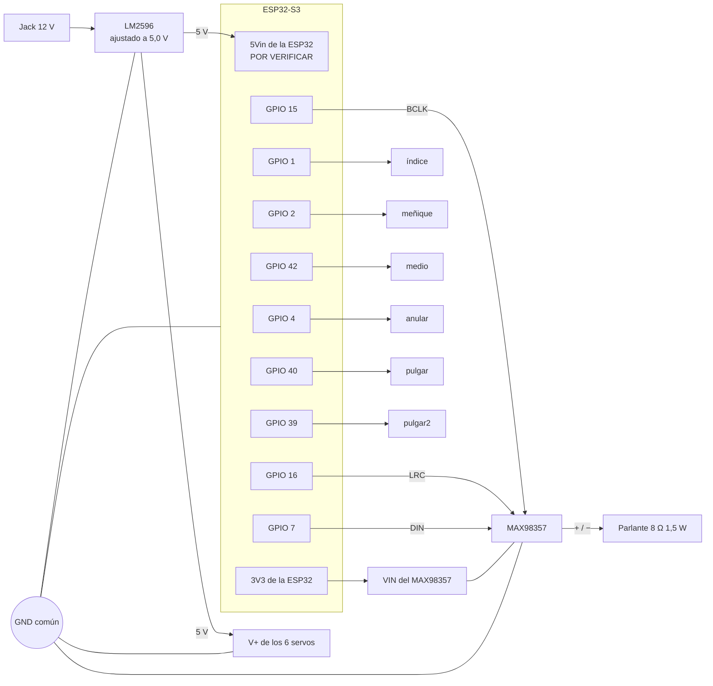

# Conexiones

Los pines salen **del código real** del firmware (`firmware_mano/main.py`, `VERSION = "voz-2"`). Lo que no está en el
código está marcado como *documentación* o **POR VERIFICAR**.

Placa: **ESP32-S3 N16R8** tipo **YD-ESP32-S3** (USB CH343, LED RGB en GPIO 48, que no se usa) con
**MicroPython v1.28.0** *Generic ESP32S3*. Esa versión no usa la PSRAM, y el proyecto funciona igual.

## 1. Tabla de pines

| Componente | Pin de la ESP32 | Dónde se define |
|---|---|---|
| Servo **índice** (señal) | GPIO **1** | `firmware_mano/main.py:22` |
| Servo **meñique** (señal) | GPIO **2** | `firmware_mano/main.py:23` |
| Servo **medio** (señal) | GPIO **42** | `firmware_mano/main.py:24` |
| Servo **anular** (señal) | GPIO **4** | `firmware_mano/main.py:25` |
| Servo **pulgar** (señal) | GPIO **40** | `firmware_mano/main.py:26` |
| Servo **pulgar2** (señal, segundo servo del pulgar; qué movimiento hace: POR VERIFICAR, ver §3) | GPIO **39** | `firmware_mano/main.py:27` |
| MAX98357 **BCLK** | GPIO **15** | `firmware_mano/main.py:13` (`PIN_BCLK = 15`) |
| MAX98357 **LRC** (WS) | GPIO **16** | `firmware_mano/main.py:14` (`PIN_LRC = 16`) |
| MAX98357 **DIN** | GPIO **7** | `firmware_mano/main.py:15` (`PIN_DIN = 7`) |
| MAX98357 **VIN** | **3V3** de la ESP32 | documentación; no está en el código (ver §3) |
| MAX98357 **GND** | GND de la ESP32 (se conecta físicamente ahí; ver §3) | documentación |
| MAX98357 **GAIN**, **SD** | sin conectar | documentación |
| Parlante 8 Ω, 1,5 W | salidas **+** y **−** del MAX98357 | documentación |

- **Servos:** PWM a **50 Hz** (`main.py:33`), con el pulso limitado entre **500 y 2500 µs** (`main.py:9-10`,
  `US_MIN` y `US_MAX`).
- **Audio:** I2S a **16 000 Hz, 16 bits, mono**, `ibuf=20000` (`main.py:16` y `main.py:286-287`). El I2S solo
  existe mientras suena un audio; después se libera.

### Los mismos pines en otros archivos

| Archivo | Pines | ¿Coinciden con `main.py`? |
|---|---|---|
| `firmware_mano/wifi_hora.py:31-33` | BCLK 15, LRC 16, DIN 7 | Sí |
| `firmware_mano/prueba_wifi_audio.py:33-35` | BCLK 15, LRC 16, DIN 7 | Sí |
| `firmware_mano/main_funciona_sin_voz.py:13-18` (respaldo) | servos 1, 2, 42, 4, 40, 39 | Sí |

**Ningún pin está definido con valores distintos en dos archivos.**

> [!CAUTION]
> **Los pines del MAX98357 son DIN 7, BCLK 15 y LRC 16.** Una configuración vieja usaba los pines **15, 48 y 47**
> y **no sonaba**: la placa respondía `voz_ok` pero el parlante quedaba mudo. No usarlos. El GPIO 48 es el LED RGB
> de la placa.

## 2. Diagrama



El mismo diagrama en texto:

```
 Jack 12 V ──► LM2596 (OUT = 5,0 V) ──┬──► V+ (rojo) de los 6 servos
                                      └──► 5Vin de la ESP32  (POR VERIFICAR en el PCB: medir 5,0 V antes, §3)

                  ESP32-S3
             ┌──────────────────┐
             │ GPIO 1  ─────────┼──► señal servo índice
             │ GPIO 2  ─────────┼──► señal servo meñique
             │ GPIO 42 ─────────┼──► señal servo medio
             │ GPIO 4  ─────────┼──► señal servo anular
             │ GPIO 40 ─────────┼──► señal servo pulgar
             │ GPIO 39 ─────────┼──► señal servo pulgar2
             │                  │            MAX98357
             │ GPIO 15 ─────────┼──► BCLK   ┌──────────┐
             │ GPIO 16 ─────────┼──► LRC    │          │ + ──┐
             │ GPIO 7  ─────────┼──► DIN    │          │     ├── Parlante 8 Ω 1,5 W
             │ 3V3     ─────────┼──► VIN    │          │ − ──┘
             │ GND     ─────────┼──► GND    └──────────┘   (GAIN y SD sin conectar)
             └──────────────────┘

 TODAS LAS TIERRAS UNIDAS: GND del LM2596 = GND de la ESP32 = GND (marrón/negro) de los servos = GND del MAX98357
 (el cable GND del MAX98357 se conecta físicamente en un pin GND de la ESP32)
```

## 3. Alimentación

**12 V → LM2596 → 5 V** para los servos. El **MAX98357 va al 3V3 de la ESP32**, no a 5 V.

1. **Ajustar el LM2596 a 5,0 V con el multímetro ANTES de conectar nada a su salida.** Sale de fábrica con otro
   voltaje, y si sale más alto puede quemar los servos y la ESP32. El ajuste se hace con el tornillo del
   potenciómetro azul.
2. **Los servos se alimentan desde el LM2596, nunca desde el pin de 5 V de la ESP32.** Seis servos moviéndose piden
   mucha más corriente de la que puede dar la placa: la ESP32 se reinicia o se daña.
3. **Todas las tierras unidas:** el GND del LM2596, el de la ESP32, el de los servos y el del MAX98357 son una
   sola tierra. Sin tierra común, los servos tiemblan o no obedecen. Para que haya menos ruido, el cable GND del
   MAX98357 **se conecta físicamente en un pin GND de la ESP32**, no en la regleta de los servos. Sigue siendo la
   misma tierra, porque la ESP32 ya está unida al LM2596.
4. **MAX98357: VIN al pin 3V3 de la ESP32.** Así se probó y así suena. **Con VIN en el pin 5Vin no sonaba:** la placa
   respondía `voz_ok`, pero el amplificador no tenía corriente. En esta placa, el pin 5Vin está separado del USB por
   unos pads rotulados «IN-OUT» (vienen separados) y no entrega los 5 V del USB.
5. **No conectar el USB y los 12 V al mismo tiempo.** El USB es solo para subir archivos con Thonny y los 12 V son
   para usar la mano.

**Con solo el USB, la mano no se mueve.** Los servos reciben corriente únicamente del LM2596, que necesita los 12 V.
Por USB la placa arranca, responde e incluso suena, porque el MAX98357 va al 3V3, pero los dedos no se mueven.

Que la ESP32 reciba los 5 V del LM2596 por el pin 5Vin cuando está con 12 V es lo esperable, pero no está
documentado en el código: **POR VERIFICAR** en el PCB. **Cómo comprobarlo:** con los 12 V puestos y **la ESP32
sin conectar**, midan con el multímetro que al punto donde va el pin 5Vin lleguen 5,0 V. Recién entonces conecten
la ESP32.

### Datos que no están en el repositorio (POR VERIFICAR)

- **Servos:** el modelo no está documentado. Usen servos de hobby que acepten pulsos de 500 a 2500 µs a 50 Hz
  (por ejemplo, del tipo SG90 o MG90S), que es lo que manda el firmware.
- **Adaptador de 12 V:** el amperaje no está documentado.
  - Calculen **al menos 1 A por servo en movimiento**.
  - El firmware mueve **un dedo a la vez** (`PAUSA_DEDO = 0.4` s entre uno y otro, `main.py:7`), pero los demás
    siguen sosteniendo su posición.
  - Un LM2596 típico entrega hasta 3 A.
  - **Si la placa se reinicia al mover la mano, la fuente es insuficiente.**
- **Condensador a la salida del LM2596:** el valor no está documentado. Si hay pitido o reinicios, ver abajo.
- **Qué mueve «pulgar2» frente a «pulgar»:** el código solo dice que son dos servos del pulgar (GPIO 39 y 40) y
  que al abrir la mano se mueve primero pulgar2. El movimiento de cada uno depende de cómo está armada la mano.
  **Cómo comprobarlo:** con 12 V, en `python fusion/consola_mano.py`, `!b` cierra los dos y `!e` los abre
  (ver [GUIA_PARA_OTROS.md](GUIA_PARA_OTROS.md), paso 8).
- **La mano en sí:** el repositorio no incluye cómo construirla (piezas, planos ni montaje).

### Ruido y reinicios (de `docs/PLAN_FUSION.md`)

- **Si la placa se reinicia al sonar o al mover la mano:** caída de voltaje. Medir que el LM2596 dé 5,0 V mientras
  suena y que el condensador de la salida esté bien puesto. También ayuda bajar `VOLUMEN` en
  `fusion/config_fusion.py` (por ejemplo a 0,25) y volver a preparar y subir los WAV.
- **Zumbido o ruido:**
  - el cable GND del MAX98357 conectado en un pin GND de la ESP32, no en la regleta de los servos (sigue siendo la
    misma tierra);
  - cables de I2S cortos (menos de 15 cm) y lejos de los de los servos;
  - cables del parlante trenzados.
  - Si es un pitido constante sin audio, viene de la fuente: un condensador cerámico de 100 nF en paralelo con el
    electrolítico del LM2596 ayuda.
