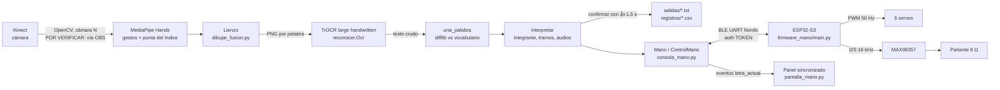

# Informe del proyecto: Kinect → mano robótica LSC → voz

Revisión hecha el 2026-11-12 leyendo los archivos reales de la carpeta (código del PC, firmware MicroPython,
`voces/`, configuración, registros y pruebas). Lo que no se puede confirmar desde el código o los archivos está
marcado **POR VERIFICAR**.

Integrantes: Jean Paul Miranda, Harry Raigozo, Lina Tatiana Maldonado y Paula Camila Enríquez
(`fusion/integrantes.json`).

---

## 1. Contexto y objetivo

El proyecto une tres proyectos anteriores del grupo:

1. **Dibujo en el aire con el Kinect**: MediaPipe sigue la mano y TrOCR lee lo dibujado. Base:
   `fusion/referencia/dibujar_original.py`, copia del `dibujar.py` original, que se conserva pero no se ejecuta.
2. **Mano robótica**: una ESP32-S3 con 6 servos deletrea en lengua de señas colombiana (LSC).
3. **Voz**: la reproducción por el amplificador MAX98357 viene del proyecto «Doby». Se copiaron `_pulir()`,
   `normalizar()` y la configuración del I2S.

**Objetivo:** que una persona dibuje en el aire el nombre, el apellido o el nombre y apellido de un integrante.
El sistema lo reconoce y lo confirma en pantalla. La mano lo deletrea letra por letra en LSC y, al final, suena
la **voz original grabada** de ese integrante.

**Restricciones que cumple el código:**
- **Todo es local.** TrOCR se carga con `HF_HUB_OFFLINE=1` y `TRANSFORMERS_OFFLINE=1` (`reconocer.py`).
- **La mano y los nombres van por Bluetooth BLE; solo el audio de la fecha y la hora va por WiFi** (botón Hora:
  `fusion/mano_wifi.py` → `firmware_mano/wifi_hora.py`). El `main.py` del repositorio no importa `network`: el
  WiFi está aparte, en `wifi_hora.py`, y se activa con 2 líneas pegadas en el `main.py` de la placa. Si el WiFi
  falla, la mano funciona igual. `config_fusion.py` no tiene IP ni puerto.
- **Sin micrófono ni reconocimiento de voz.** La única entrada es la cámara.
- **Sin voz sintética ni clonada en los nombres.** Los nombres solo suenan con los archivos de `voces/`,
  convertidos a WAV. Única excepción: la fecha y la hora del botón **Hora**, con la voz clonada (F5-TTS) de cada
  integrante; ver [GUIA_VOZ_CLONADA_Y_HORA.md](GUIA_VOZ_CLONADA_Y_HORA.md).
- **Solo el primer apellido.** Harry se reconoce solo como «Harry» o «Raigozo»: la palabra «Jean» pertenece
  únicamente a Jean Paul Miranda.

---

## 2. Arquitectura



**Flujo en el PC** (`fusion/dibujar_fusion.py`, clase `Sesion`), con los estados del código:

```
DIBUJANDO ──👍──> LEYENDO ──(OCR en orden)──> CONFIRMAR ──👍 1,5 s──> DELETREANDO ──> DIBUJANDO
                                   └──> RECHAZADO (3 s, no se manda nada) ──> DIBUJANDO
                                                          DELETREANDO ──Esc──> DETENIENDO (detener + reset) ──> DIBUJANDO
```

**Orden de las órdenes a la placa en un deletreo** (`Mano._deletrear` en `consola_mano.py`):

1. `reset`.
2. Para cada palabra, para cada **tramo**, que es un grupo de letras estáticas seguidas:
   - **Tramo de 2 o más letras:** se manda el tramo (por ejemplo `lina`) y el PC espera `deletreo_completo`.
   - **Tramo de 1 letra:** se manda la letra, el PC espera `gesto_x_ok`, pasa 1 s y manda `reset`.
   - **Letra con movimiento:** el PC manda `reset`, la letra se muestra 1,5 s en pantalla y la mano queda abierta.
   - **Entre palabras:** `reset` y una pausa de 1 s.
3. Al final, `reset`.
4. Después, `voz <archivo> [<archivo> …]`, y el PC espera `voz_ok`.

---

## 3. Hardware y conexiones

### 3.1 Placa
ESP32-S3 N16R8 con MicroPython (`firmware_mano/main.py`).
- La placa es tipo YD-ESP32-S3, con USB CH343 y LED RGB en el GPIO 48, que no se usa. Esto viene de `CLAUDE.md`
  y `docs/PLAN_FUSION.md`, no del código: **POR VERIFICAR** en la placa física.

### 3.2 Servos
Los pines y los pulsos en µs salen de `dedos_config` en `firmware_mano/main.py`. Los servos van a 50 Hz y el pulso
está limitado entre 500 y 2500 µs.

| Dedo | GPIO | Abierto | Cerrado | Mitad |
|---|---|---|---|---|
| índice | 1 | 500 | 2000 | 1000 |
| meñique | 2 | 500 | 2000 | 1200 |
| medio | 42 | 500 | 2000 | 1000 |
| anular | 4 | 2200 | 500 | 1700 |
| pulgar | 40 | 1500 | 500 | 1000 |
| pulgar2 | 39 | 700 | 2300 | 1600 |

- `PAUSA_DEDO = 0.4` s después de mover cada dedo; si el dedo ya está en su lugar, no espera.
- `PAUSA_LETRA = 1.0` s mostrando cada letra.
- `reset_all()` abre la mano en este orden: pulgar2, pulgar, índice, medio, anular, meñique.
- El PWM no se suelta en reposo.
- En el código el pulgar tiene el comentario «antes abierto era 10: calibrar». **POR VERIFICAR** si quedó
  calibrado.

### 3.3 Amplificador MAX98357 (I2S, en la misma ESP32)

| MAX98357 | ESP32 | Fuente |
|---|---|---|
| DIN | GPIO 7 | `PIN_DIN = 7` |
| BCLK | GPIO 15 | `PIN_BCLK = 15` |
| LRC | GPIO 16 | `PIN_LRC = 16` |
| VIN | 3V3 | `CLAUDE.md` (confirmado de oído el 2026-10-28); no está en el código |
| GND | GND | documentación |
| GAIN, SD | libres | documentación |

- I2S configurado así: `I2S(0, …, bits=16, format=I2S.MONO, rate=16000, ibuf=20000)`.
- El I2S solo se crea mientras suena un audio y después se libera (`deinit`).
- Parlante de 8 Ω y 1,5 W en + y − del amplificador, según la documentación: **POR VERIFICAR** físicamente.

> **Pines correctos: DIN 7, BCLK 15, LRC 16**, los del firmware actual (`VERSION = "voz-2"`), con los que suena.
> **15, 48 y 47 eran la configuración vieja, que no funcionaba**: la placa respondía `voz_ok` pero no sonaba
> nada. No deben usarse.

### 3.4 Alimentación
- **Del código solo se sabe** que el firmware no mide ni controla la alimentación.
- **Según la documentación** (`CLAUDE.md`, `docs/PLAN_FUSION.md`): **POR VERIFICAR** en el PCB.
  - PCB casera con jack de 12 V y regulador LM2596.
  - **No se pueden conectar el USB y los 12 V a la vez.** El USB se usa solo para subir archivos con Thonny y los
    12 V para usar la mano.
  - El MAX98357 va a **3V3**. El pin 5Vin no recibe los 5 V del USB porque los pads «IN-OUT» de la placa están
    separados.

---

## 4. Software

### 4.1 Archivos

| Archivo | Qué hace | Funciones / clases clave |
|---|---|---|
| `fusion/dibujar_fusion.py` | **Programa principal.** Cámara, MediaPipe, gestos, lienzo, cola de OCR, confirmación, deletreo + voz en hilos, panel sincronizado, registros. | `clasificar()` y los gestos `is_*`; `una_palabra()`; `Sostener`; `ColaOcr`; `ControlMano`; `Sesion`; `guardar_txt()`; `guardar_ocr()`; `bucle_camara()`; `main()` |
| `fusion/reconocer.py` | OCR y reconocimiento de integrantes. | `Ocr.leer()`; `normalizar()`; `palabras_de()`; `tramos()`; `emparejar_palabra()`; `interpretar()` → `Resultado`; `Integrantes` (`buscar_audio`) |
| `fusion/consola_mano.py` | Cliente BLE de la mano, con su propio hilo y bucle asyncio. Deletreo por tramos, modo consola `!orden`, `tiempos_mano.csv`. | `Mano.conectar/deletrear/reset/hablar/version/detener/cerrar`; `leer_config()` (lee el token sin ejecutar el archivo) |
| `fusion/voz.py` | Convierte los audios de `voces/` a WAV de 16 kHz para la placa y manda la orden `voz`. Escribe `tiempos_voz.csv`. | `Audios.palabra_procesada/preparar_placa/elegir`; `Voz.preparar/hablar/comprobar_placa`; `preparar_todo()` |
| `fusion/pantalla_mano.py` | Ejecuta en el PC las funciones de la mano del propio firmware, en tiempo virtual, para mostrar la letra actual sincronizada. | `RelojMano`; `Seguimiento`; `VentanaMano` |
| `fusion/config_fusion.py` | Parámetros del audio. | `TASA=16000`, `VOLUMEN=0.35`, `CORTE_GRAVES=100`, `SILENCIO_FINAL=0.3`, `RAMPA_MS=2`, `RECORTAR_SILENCIO=False` |
| `fusion/integrantes.json` | Personas, palabras, frases, audios, `ambiguos` (`jean`→`jeanpaul`), `no_usar`, pausa de 250 ms. | — |
| `firmware_mano/main.py` | Firmware de la placa: servos, 21 letras, deletreo, voz por I2S, servidor BLE y lectura por USB. | `reset_all()`; las letras `a()`…`y()`; `deletrear()`; `reproducir_voz()`; `atender_orden()`; `ServidorBLE`; `LectorUSB` |
| `firmware_mano/main_funciona_sin_voz.py` | Respaldo del firmware anterior a la voz; lo compara `comparar_firmware.py`. | — |
| `fusion/referencia/dibujar_original.py` | Copia del programa original del Kinect. **No se ejecuta.** | — |
| `fusion/pruebas/*.py` | Pruebas sin Kinect ni placa (sección 8.5). | — |
| `fusion/hora.py`, `fusion/hora.json`, `fusion/mano_wifi.py`, `firmware_mano/wifi_hora.py`, `fusion/voz_pc.py`, `clonacion/` | Botón **Hora**: fecha y hora con voz clonada (por WiFi a la placa, o por el PC con `--voz-pc`) y los scripts de clonación. Detalle en [GUIA_VOZ_CLONADA_Y_HORA.md](GUIA_VOZ_CLONADA_Y_HORA.md). | `hora.elegir/decir`; `mano_wifi.conectar`; `Wifi.atender` (placa); `VozPC` |
| `config_ble.ejemplo.py` | Plantilla de `config_ble.py` (`NOMBRE`, `TOKEN`). | — |

### 4.2 Dependencias
Versiones instaladas hoy en el PC; `requirements.txt` fija las mismas.

| Paquete | Versión | Lo usa |
|---|---|---|
| Python | 3.11.9 | todo (`py -3.11`) |
| torch | 2.11.0+cu128 | TrOCR |
| transformers | 4.57.6 | TrOCR (`microsoft/trocr-large-handwritten`) |
| opencv-python | 5.0.0.93 | cámara, ventana, imagen |
| mediapipe | 0.10.9 | `mp.solutions.hands` |
| numpy | 2.4.6 | imagen, audio |
| scipy | 1.17.1 | filtro pasa-altos y remuestreo del audio |
| pillow | 12.3.0 | texto con tildes en pantalla, entrada de TrOCR |
| bleak | 3.0.2 | BLE |
| ffmpeg / ffprobe | 9.0.1 (essentials) | decodificar los audios (en el PATH) |

- Si se cambia el orden de importación aparece el error de `c10.dll` (WinError 1114). Por eso `dibujar_fusion.py`
  importa `torch` antes que `cv2`, `mediapipe`, `PIL` y `bleak`.
- En el firmware: MicroPython con `machine` (`Pin`, `PWM`, `I2S`) y `bluetooth`. La versión de MicroPython de la
  placa está **POR VERIFICAR**.

### 4.3 Gestos (MediaPipe → `clasificar()`)

| Gesto | Acción | Tiempo sostenido |
|---|---|---|
| índice | dibuja | — |
| mano abierta | levanta el lápiz | — |
| pulgar abajo | siguiente palabra (se encola para el OCR) | 1,0 s |
| pulgar arriba | terminar (en CONFIRMAR: confirmar) | 0,6 s (confirmar: 1,5 s) |
| dos (índice + medio) | quitar la última palabra | 1,0 s |
| shaka | borrar el lienzo (en CONFIRMAR: volver a dibujar) | 0,6 s |
| tres dedos | cambiar color | 0,6 s |

- Después de cada acción hay que **soltar el gesto**: 5 cuadros con otro gesto o sin la mano.
- Máximo 4 palabras.
- Teclas: `r` reconecta, `d` activa el diagnóstico, `Esc`/`q` sale. Durante el deletreo, `Esc` detiene la mano y
  la abre.

### 4.4 Cómo se reconoce un nombre

1. **Imagen.** Cada palabra es un dibujo aparte. `Ocr.leer()` redimensiona el lienzo a 640×480, lo pasa a fondo
   blanco con trazo negro y lo erosiona con un núcleo de 5×5 dos veces. Así lo hacía el original.
   - Guarda `<fecha>_<n>.png` (el lienzo) y `<fecha>_<n>_trocr.png` (lo que recibe el modelo) en
     `fusion/registros/ocr_imagenes/`.
2. **TrOCR.** `generate(max_new_tokens=12, no_repeat_ngram_size=2)`, con 12 tokens por palabra en
   `dibujar_fusion.py`; `reconocer.py --imagen` usa 40.
3. **`una_palabra(crudo)`:**
   - quita signos, números y tildes;
   - toma como candidatos cada palabra y todas unidas («Mal donado» → «maldonado»);
   - elige la más parecida al vocabulario con `difflib.SequenceMatcher`, si supera `UMBRAL = 0.75`;
   - si ninguna lo supera, se queda con la más larga, como el original.
   - Ejemplos: «Jean Jean» → Jean, «Jean F.» → Jean, «1902 Lina» → Lina.
4. **`interpretar(texto)`:**
   - cada palabra se compara con el vocabulario: primero la coincidencia exacta y luego `UMBRAL` 0,75 con
     `MARGEN` 0,10 sobre la segunda opción; si no pasa el margen, es dudosa y se rechaza («¿Paul o Paula?»);
   - se acepta cualquier grupo de palabras de **una sola persona**, **en orden** y **sin repetir**. Una mezcla de
     personas, el desorden o una repetición dan «No coincide con un integrante»;
   - «Jean» solo se resuelve como Jean Paul por `ambiguos`.
5. **`tramos(palabra)`** corta la palabra en las letras con movimiento, por ejemplo
   `raigozo` → `rai | [g] | o | [z] | o`.
6. **Audio (`Audios.elegir`):** si lo reconocido es exactamente una frase con grabación, suena solo esa. Si no,
   suenan las palabras sueltas con 250 ms entre ellas.

---

## 5. Protocolo BLE

| Dato | Valor (código) |
|---|---|
| Nombre anunciado | `Mano-LSC` (`NOMBRE` de `config_ble.py`; por defecto `Mano-LSC`) |
| Servicio | UART de Nordic `6E400001-B5A3-F393-E0A9-E50E24DCCA9E` |
| RX (el PC escribe) | `6E400002-B5A3-F393-E0A9-E50E24DCCA9E` (write / write without response) |
| TX (la placa notifica) | `6E400003-B5A3-F393-E0A9-E50E24DCCA9E` (read / notify) |
| Formato | texto UTF-8, una orden por línea (`\n`), en trozos de 20 bytes en los dos sentidos |
| Autenticación | primera línea `auth <TOKEN>` en 3 s (si no, desconecta); TOKEN de 16 caracteres o más; responde `ok:auth` o `error:auth` |
| Clientes | uno a la vez (al conectarse uno, la placa deja de anunciarse) |

| Orden del PC | Respuesta de la placa |
|---|---|
| palabra de 2 o más letras (`lina`) | por cada letra: `gesto_x_ok` y `letra_actual:x`; o `letra_x_no_disponible`. Al final, `deletreo_completo` (y abre la mano) |
| una letra (`o`) | `gesto_o_ok` (la letra queda puesta) |
| `reset` o `1` | `reset_ok` |
| `version` o `?` | `version:voz-2` (el PC usa `?`) |
| `voz a b …` | `voz_ok`, `voz_falta:a,b` (no suena nada) o `voz_error:i2s` / `voz_error:lectura` |
| otra cosa | `comando_no_reconocido` |
| `salir` | termina el bucle del firmware |

- **Esperas del PC:** busca la placa durante 10 s; espera hasta 20 s por cada respuesta; la espera de `voz_ok` es
  la duración del audio + 0,93 s + 5 s.
- Las mismas órdenes funcionan por USB desde la consola de Thonny.

---

## 6. Letras

Según `acciones` en `firmware_mano/main.py` y `LETRAS_ESTATICAS` en `reconocer.py`:

| Grupo | Letras | Qué pasa |
|---|---|---|
| **Las hace la mano** (21) | a b c d e f i k l m n o p q r t u v w x y | forma la letra, espera 1 s y continúa |
| **Solo en pantalla** (llevan movimiento) | g h j ñ s z | el PC manda `reset` (mano abierta), muestra la letra en grande 1,5 s y sigue |
| Dobles | rr, ll | se deletrean como dos letras estáticas |

- Los números y signos se descartan antes de deletrear.
- Que las 21 formas sean correctas en LSC está **POR VERIFICAR** por alguien que sepa LSC; el código solo define
  las posiciones de los dedos.

---

## 7. Inventario de audios

Se esperan **18 archivos** en `voces/`: 5 por persona, salvo Harry, que tiene 3. Van sin tildes y con guion bajo.
Sirve cualquier extensión `.mp3 .mp4 .m4a .wav .ogg .mpeg`, incluida la doble de WhatsApp. La búsqueda no
distingue mayúsculas.

Estado al 2026-11-12, comprobado con `Integrantes.buscar_audio()` del propio programa y duraciones de `ffprobe`:

| Persona | Archivo esperado (base) | Estado | Archivo encontrado | Duración |
|---|---|---|---|---|
| Jean Paul | `JEAN` | ✔ | `JEAN.mp4` | 1,51 s |
| Jean Paul | `Paul` | ✔ | `Paul.mp4` | 1,56 s |
| Jean Paul | `Miranda` | ✔ | `Miranda.mp4` | 1,49 s |
| Jean Paul | `Jean_Miranda` | ✔ | `Jean_Miranda.mp4` | 1,98 s |
| Jean Paul | `Jean_Paul_Miranda` | ✔ | `Jean_Paul_Miranda.mp4` | 2,35 s |
| Harry | `Harry` | ✔ | `harry.mp3` | 2,30 s |
| Harry | `Raigozo` | ✔ | `raigozo.mp3` | 2,51 s |
| Harry | `Harry_Raigozo` | ✔ | `Harry_Raigozo.mp3` | 2,30 s |
| Lina | `Lina` | ✔ | `Lina.mp3.mpeg` | 1,73 s |
| Lina | `Tatiana` | ✔ | `Tatiana.mp3` | 1,64 s |
| Lina | `Maldonado` | ✔ | `Maldonado.mp3` | 1,90 s |
| Lina | `Lina_Maldonado` | ✔ (renombrado el 2026-11-12; antes `Lina_Maldonado.mp3 (1).mpeg`, que no se encontraba) | `Lina_Maldonado.mp3` | 2,58 s |
| Lina | `Lina_Tatiana_Maldonado` | ✔ | `Lina_Tatiana_Maldonado.mp3` | 2,92 s |
| Paula | `Paula` | **✗ falta** | — | — |
| Paula | `Camila` | ✔ | `camila.mp3` | 3,20 s |
| Paula | `Enriquez` | ✔ | `enriquez.mp3` | 2,84 s |
| Paula | `Paula_Enriquez` | ✔ | `paula_enriquez.mp3` | 5,29 s |
| Paula | `Paula_Camila_Enriquez` | ✔ | `paula_camila_enriquez.mp3` | 9,15 s |

**17 de 18 listos.** Falta solo **`Paula`**, que hay que grabar. Mientras falte, «Paula» sola da «Falta audio:
Paula».

`Lina_Maldonado` se arregló el 2026-11-12:
- El archivo se llamaba `Lina_Maldonado.mp3 (1).mpeg` y el « (1)» que agregó Windows impedía encontrarlo; se
  renombró a `Lina_Maldonado.mp3`.
- El programa ya lo encuentra y lo decodifica: es MP3 y dura 2,58 s.
- «Lina Maldonado» ahora suena con la frase grabada (`voz lina_maldonado`).
- Falta convertirlo con `voz.py --preparar` y subir `lina_maldonado.wav` a `/voz` de la placa.

**Otras observaciones:**
- `harry.mp3` y `Harry_Raigozo.mp3` duran exactamente lo mismo (2,298 s), aunque son archivos distintos.
  **POR VERIFICAR de oído** que el segundo diga «Harry Raigozo».
- Todos duran al menos 1 s, como exige la lista de grabación.
- Que los WAV estén **en la placa** (`/voz`) no se puede comprobar desde el PC sin conectarse: **POR VERIFICAR**
  con `!voz <nombre>` en `consola_mano.py`.
- En git solo están versionados 9 audios antiguos, del commit `d56f1af`, aunque `.gitignore` excluye `voces/`. Los
  nuevos no entran en git.

---

## 8. Cómo ejecutarlo

### 8.1 Instalar (PC con Windows)
1. **Python 3.11:** `py -3.11 -m pip install -r requirements.txt`.
2. **TrOCR:** la primera vez se descarga a la caché de Hugging Face. Después se carga sin internet. El comando
   está en el `README.md`.
3. **ffmpeg y ffprobe** en el PATH (`ffmpeg -version`).
4. **Kinect como cámara:** el programa abre la cámara con índice 1 (`cv2.VideoCapture(1, cv2.CAP_DSHOW)`;
   `--camara N` para cambiarla). Que se haga a través de la cámara virtual de OBS figura en el `README.md`:
   **POR VERIFICAR** la configuración exacta.
5. **Token:** copiar `config_ble.ejemplo.py` como `config_ble.py` y poner un `TOKEN` de 16 caracteres o más. El
   mismo archivo va en el PC y en la placa.

### 8.2 Subir a la ESP32 (Thonny, placa solo por USB, sin 12 V)
1. Clic derecho sobre `firmware_mano/main.py` → «Subir a /». Subir también `config_ble.py` a `/`.
2. Crear la carpeta `/voz` en la placa. Subir ahí los `.wav` de `fusion/audios_placa/`, que se generan con
   `py -3.11 fusion/voz.py --preparar`.
3. Ctrl+D y escribir `version`; debe responder `version:voz-2`.
4. Cerrar Thonny, quitar el USB y conectar los 12 V.

### 8.3 Correr el programa
```
cd C:\Users\miran\mano_pruebas_consola
py -3.11 fusion/dibujar_fusion.py               (--camara N, --diagnostico)
```
- Antes de correrlo: Bluetooth del PC activado y Thonny o cualquier otro programa conectado a la mano cerrado.
- Primero carga TrOCR, luego busca la mano en segundo plano y abre la ventana. Si la mano no conecta, se puede
  dibujar igual: el `.txt` se guarda y la tecla `r` reintenta la conexión.

### 8.4 Comandos por partes
```
py -3.11 fusion/consola_mano.py                        consola de la mano (!version, !voz jean, reset, salir)
py -3.11 fusion/voz.py --texto "Lina"                  solo suena
py -3.11 fusion/voz.py --texto "Lina" --deletrear      deletrea con el panel y después suena
py -3.11 fusion/reconocer.py --texto "Jaen Mirnda"     solo el reconocimiento
py -3.11 fusion/reconocer.py --imagen fusion/pruebas/palabra.png
```

### 8.5 Pruebas (sin Kinect ni placa)
Resultado al correrlas el 2026-11-12:

| Prueba | Resultado |
|---|---|
| `fusion/reconocer.py --pruebas` | 23 de 23 |
| `fusion/pruebas/prueba_dibujar_falsa.py` | 0 fallas (12 casos) |
| `fusion/pruebas/prueba_mano_falsa.py` | 0 fallas |
| `fusion/pruebas/prueba_firmware_voz.py` | 0 fallas |
| `fusion/pruebas/prueba_voz_ble_falsa.py` | 0 fallas |
| `fusion/pruebas/prueba_reloj.py` | 0 fallas |
| `fusion/pruebas/comparar_firmware.py` | la parte de la mano es idéntica al respaldo |

---

## 9. Estado actual

### 9.1 Qué funciona
Con datos reales de `fusion/registros/`, del 2026-10-28 al 2026-11-04:

- **Mano por BLE:** 41 deletreos registrados en `tiempos_mano.csv`, los 41 con resultado `ok`.
  - 29 de ellos son de «Lina», hechos en las pruebas de C2.
  - El tiempo medido entre letras estáticas fue de 4,28 s de media (mediana 4,97 s; 213 letras). Incluye abrir la
    mano, formar la letra (0,4 s por dedo) y mostrarla 1 s.
- **Voz por la placa:** 13 de 14 intentos con `voz_ok` en `tiempos_voz.csv`.
  - Entre el fin del audio y la respuesta pasaron 1,14 s de media (de 1,02 a 1,29 s).
  - El único error fue «La mano no respondió a tiempo».
- **OCR + reconocimiento** (`ocr.csv`, 21 palabras en 16 intentos):
  - Coincidió en 10 de 16 intentos. Los 4 primeros son anteriores a `una_palabra()`; desde ese cambio, 10 de 12.
  - TrOCR tardó 2,26 s de media por palabra (de 1,35 a 7,46 s).
- **Programa completo** (`dibujar_fusion.py`): probado con el Kinect y la placa real según `CLAUDE.md`.
  - Hay 7 nombres confirmados en `fusion/salidas/`: jeanpaul ×4, lina ×2 y paula ×1.
- Las pruebas automáticas pasan (sección 8.5).

### 9.2 Problemas conocidos
1. **El OCR agrega texto que no se dibujó.** En `ocr.csv` aparecen «2021 22 May», «1902 Lina», «2 LINA 0»,
   «Jean Jean» y «Jean F.». `una_palabra()` y `palabras_de()` quitan números y repeticiones, pero:
   - «Taryana» no llegó al umbral para «Tatiana» y se rechazó;
   - «0 0» no da nada.
2. **Falta el audio `Paula`** (sección 7). `Lina_Maldonado` ya se renombró y se encuentra.
3. **Documentación desactualizada respecto al código y a `voces/`:**
   - `docs/LISTA_GRABACION.md` dice «6 listos, faltan 12».
   - `docs/PLAN_FUSION.md` §9 todavía menciona el botón «↶ Deshacer», que fue reemplazado por el gesto ✌️.
   - (`CLAUDE.md` ya se actualizó el 2026-11-12; la versión anterior quedó en `CLAUDE_anterior.md`.)
4. **Quedó `fusion/firmware_mano/__pycache__/`**, un caché de una ubicación vieja del firmware. Lo ignora
   `.gitignore` y no afecta.
5. **Git:**
   - hay cambios sin commit en `fusion/registros/*.csv`, una imagen de OCR y `fusion/salidas/2026-11-04_…_paula.txt`;
   - los commits tienen el autor `tu_correo@ejemplo.com` (un correo de ejemplo);
   - `config_ble.py` nunca entró al historial.

### 9.3 Limitaciones reales
- Solo reconoce las **palabras de los 4 integrantes** (vocabulario cerrado de `integrantes.json`), hasta 4 palabras,
  de una sola persona y en orden.
- **6 letras (g h j ñ s z) no las hace la mano;** solo se muestran en pantalla.
- **Es lento:** unos 4–5 s por letra. Un nombre de 7 letras tarda cerca de medio minuto antes de que suene la voz.
- **Un solo cliente BLE.** Thonny o una consola abierta bloquean la conexión.
- **USB y 12 V no van a la vez,** así que para cambiar audios o firmware hay que desconectar la alimentación.
- **El OCR depende del trazo en el aire.** Cada palabra debe dibujarse aparte y con letra clara.
- Los audios se reproducen **tal como se grabaron**: sin recorte ni reducción de ruido, solo con el volumen
  igualado.
- `guia_graficas/` tiene **datos sintéticos**, solo como plantilla de formato. No son resultados.

---

## 10. Pendientes y próximos avances (en orden)

1. **Grabar el audio «Paula»** (`voces/Paula.*`): al menos 1 s, con silencio antes y después.
2. **Escuchar `voces/Harry_Raigozo.mp3`** para confirmar que dice «Harry Raigozo» (sección 7).
3. Correr `py -3.11 fusion/voz.py --preparar` y **subir los WAV nuevos a `/voz`**: `lina_maldonado.wav` y, cuando
   exista, `paula.wav`. Comprobar con `!voz lina_maldonado` y `!voz paula` en `consola_mano.py`.
4. **Sacar `voces/` del versionado** con `git rm -r --cached voces`. Los archivos se quedan en el disco y
   `.gitignore` ya los excluye. **Lo hace el usuario.**
5. **Corregir el autor de git:** hoy los commits dicen `tu_correo@ejemplo.com`. **Lo hace el usuario.**
6. **Actualizar la documentación:** `docs/LISTA_GRABACION.md` (18 audios, estado real) y `docs/PLAN_FUSION.md` §9
   (gesto ✌️).
7. **Crear `docs/SUSTENTACION.md`:** qué prender y en qué orden, qué cerrar, el comando único, la cámara, qué hacer
   si la mano no conecta o la voz no suena, y cómo subir audios.
8. **Commit de los registros nuevos** (`fusion/registros/`, `fusion/salidas/`). Lo hace el usuario.
9. **Gráficas con datos reales** de `fusion/registros/*.csv`, usando `guia_graficas/` solo como formato:
   - tiempo por letra;
   - tiempo hasta `voz_ok`;
   - aciertos del OCR por intento;
   - tiempo del OCR.
10. **Más pruebas con el Kinect** para medir el OCR: por ejemplo 3 dibujos por palabra de cada integrante, anotando
    en `ocr.csv` si coincidió. Con eso se puede **ajustar `UMBRAL`**, hoy en 0,75; el caso «Taryana» quedó por
    debajo.
11. **Informe final** con números propios: los de la sección 9.1 y los de las pruebas nuevas.
12. **Mejoras opcionales:**
    - bajar `PAUSA_DEDO` y `PAUSA_LETRA` si la mano lo tolera (hay que medirlo con `tiempos_mano.csv`);
    - calibrar el pulgar (el comentario «calibrar» del firmware);
    - marcar en la lista de palabras de la pantalla si cada una coincide (decisión abierta 9 del plan).
