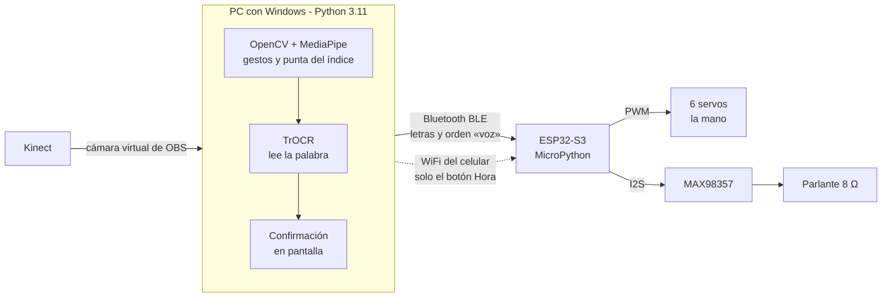

# Kinect → mano robótica LSC → voz

Se **escribe en el aire**, frente al Kinect, el nombre, el apellido o el nombre y apellido de un integrante del
grupo. El PC lo lee con **TrOCR**, una **mano robótica** lo **deletrea letra por letra** en lengua de señas
colombiana (LSC) y, al terminar, suena el nombre **con la voz grabada de esa persona** por un parlante conectado a
la misma placa de la mano.

Además, un botón **«Hora»** dice la fecha y la hora con la voz de uno de los integrantes (hasta 4 voces).

> [!IMPORTANT]
> **El repositorio NO incluye las grabaciones de voz.** Para usarlo hay que grabar las propias:
> ver **[GUIA_PARA_OTROS.md](GUIA_PARA_OTROS.md)**. Las carpetas de audio están vacías, cada una con un
> `LEEME.md` que dice qué archivos van ahí, con qué nombre y en qué formato.

Proyecto universitario — **Universidad de Cundinamarca, sede Facatativá**.

## Integrantes

| Integrante | La mano lo reconoce escrito como |
|---|---|
| Jean Paul Miranda | Jean, Paul, Miranda y sus combinaciones (Jean Miranda, Jean Paul Miranda) |
| Harry Raigozo | Harry, Raigozo, Harry Raigozo |
| Lina Tatiana Maldonado | Lina, Tatiana, Maldonado y sus combinaciones |
| Paula Camila Enríquez | Paula, Camila, Enríquez y sus combinaciones |

Solo se usa el **primer apellido**. Si se mezclan palabras de dos personas, la pantalla dice «No coincide con un
integrante» y no se manda nada.

## Cómo funciona



En texto:

```
Kinect ──► PC (OBS → OpenCV → MediaPipe → TrOCR → confirmación) ──BLE──► ESP32-S3 ──► 6 servos (deletrea)
                                                                │                 └─► MAX98357 ──► parlante (voz)
                                                                └──WiFi (solo Hora)─►┘
```

1. Con el **índice** se escribe en el aire una palabra. Con el **pulgar abajo** se pasa a la siguiente. Se pueden
   escribir hasta 4 palabras.
2. **TrOCR** lee cada palabra y el programa busca el integrante que más se parece en `fusion/integrantes.json`.
3. En pantalla aparece «Leí … → Entendí …». Con el **pulgar arriba 1,5 s** se confirma.
4. El PC manda las letras a la ESP32 por **Bluetooth BLE**. La mano deletrea y la pantalla muestra cada letra.
5. Al final, la ESP32 hace sonar por el **MAX98357** la grabación original del nombre (WAV guardado en la placa).

Todo corre **en local**: sin APIs en la nube, y TrOCR corre en el PC sin internet. No hay micrófono.

## Materiales

| Componente | Detalle |
|---|---|
| Placa | **ESP32-S3 N16R8** tipo **YD-ESP32-S3** (USB CH343, LED RGB en GPIO 48, que no se usa) |
| Firmware | **MicroPython v1.28.0**, versión *Generic ESP32S3*. Esta versión **no usa la PSRAM** y el proyecto funciona igual |
| Servos | 6 (índice, medio, anular, meñique, pulgar y pulgar2, un segundo servo del pulgar). El modelo no está documentado (POR VERIFICAR): sirven servos de hobby de 500–2500 µs a 50 Hz, por ejemplo del tipo SG90 o MG90S |
| Alimentación | Placa de expansión casera con **jack de 12 V** y **regulador LM2596** (12 V → 5 V para los servos). El amperaje del adaptador no está documentado (POR VERIFICAR): calculen al menos 1 A por servo en movimiento; si la placa se reinicia al mover la mano, la fuente es insuficiente |
| Audio | Amplificador **MAX98357** (I2S), alimentado desde el **3V3 de la ESP32**, y parlante de **8 Ω, 1,5 W** |
| Cámara | **Kinect**, usado como cámara a través de OBS. También sirve cualquier webcam |
| PC | **Windows** con Bluetooth, Python 3.11 y ffmpeg |
| WiFi (solo botón Hora) | Punto de acceso de un celular |

Pines y diagrama de conexión: **[CONEXIONES.md](CONEXIONES.md)**.

> [!NOTE]
> **El repositorio no incluye cómo construir la mano** (piezas, planos ni montaje): solo el firmware y el programa.
> Cada grupo usa su propia mano con 6 servos y la calibra.

> [!WARNING]
> **No conectar el USB y los 12 V al mismo tiempo.** El USB es solo para subir archivos con Thonny y los 12 V
> son para usar la mano. **Con solo el USB la mano no se mueve:** los servos necesitan los 12 V.

## Cómo ejecutarlo

La instalación completa, paso a paso, está en **[GUIA_PARA_OTROS.md](GUIA_PARA_OTROS.md)**. En resumen,
siempre con el entorno virtual activado y `python`:

```
py -3.11 -m venv .venv
.venv\Scripts\activate
python -m pip install torch==2.11.0 --index-url https://download.pytorch.org/whl/cu128
python -m pip install -r requirements.txt
python fusion/voz.py --preparar
```

- La línea de torch es para un PC con GPU NVIDIA. Sin GPU: `python -m pip install torch==2.11.0`.
- El último comando convierte `voces/` en WAV para la placa y necesita ffmpeg.

1. Crear `config_ble.py` (y, para el botón Hora, `config_wifi.py` y `secretos.py`) a partir de las plantillas
   `*.ejemplo.py`.
2. Con Thonny y la placa **solo por USB**, subir:
   - a la raíz de la placa: `config_ble.py`, `firmware_mano/main.py` y, para el botón Hora,
     `firmware_mano/wifi_hora.py` y `config_wifi.py`;
   - a la carpeta `/voz` de la placa: los WAV de `fusion/audios_placa/`.
3. Quitar el USB, conectar los 12 V y ejecutar:

```
python fusion/dibujar_fusion.py                 programa completo (Kinect = cámara 1)
python fusion/dibujar_fusion.py --camara 0      otra cámara (por ejemplo, la webcam del portátil)
python fusion/dibujar_fusion.py --voz-pc        plan B: las voces suenan por los parlantes del PC
python fusion/dibujar_fusion.py --diagnostico   muestra el gesto que detecta MediaPipe
```

Antes de ejecutarlo: Bluetooth del PC activado, y Thonny o cualquier otro programa conectado a la mano **cerrados**.
La placa atiende a un solo cliente a la vez.

## Qué se ve en pantalla

La imagen de la cámara, con el trazo encima, y un panel con el estado de la mano.

| Gesto | Qué hace |
|---|---|
| ☝️ Índice | Dibuja |
| 🖐️ Mano abierta | Levanta el lápiz |
| 👎 Pulgar abajo, 1 s | Siguiente palabra (máximo 4) |
| 👍 Pulgar arriba | Terminar; en la confirmación, **1,5 s** confirma |
| ✌️ Índice + medio, 1 s | Quitar la última palabra |
| 🤙 Shaka | Borrar la palabra actual o volver a dibujar |
| Tres dedos | Cambiar de color |

Teclas: `r` reconecta la mano · `d` activa o quita el modo diagnóstico · `h` abre el menú de la hora · `Esc` o `q`
salen (durante el deletreo, `Esc` detiene la mano y la abre).

**Botón «Hora»** (arriba a la derecha, dentro de la imagen; ahí no se dibuja):
1. Se apunta con el índice al botón durante 1 s, o se presiona la tecla `h`.
2. Aparece un menú con **hasta 4 voces**. Se elige una apuntándola 1 s, o con las teclas `1` a `4`. Con shaka o `Esc`
   se cierra, y si nadie elige, se cierra solo a los 5 s.
3. La mano dice, por ejemplo, «Hoy es viernes veinte de noviembre. Son las diez en punto de la noche.» con la
   voz elegida. El audio viaja por **WiFi** desde el PC a la ESP32. El dibujo no se borra.

La fecha y la hora usan **voz clonada** (F5-TTS) a partir de grabaciones de cada integrante; es la única parte con
voz clonada. Los nombres siempre suenan con la grabación original. Sin esos audios, el botón Hora no funciona y el
resto del programa sí. Cómo generarlos (parte opcional y la más difícil): [GUIA_PARA_OTROS.md](GUIA_PARA_OTROS.md),
paso 12.

## Limitaciones conocidas

- **Letras con movimiento:** la mano hace las **21 letras estáticas** de LSC
  (a b c d e f i k l m n o p q r t u v w x y). Las que necesitan movimiento de muñeca o antebrazo
  (**g h j ñ s z**) no las puede hacer: se muestran en grande en pantalla, la mano se abre y sigue con la
  siguiente letra. `rr` y `ll` se hacen como dos letras.
- **Solo el primer apellido.**
- **Botón Hora:** la fecha solo suena en los días que se generaron (en este proyecto, del 12 de noviembre al 31
  de diciembre de 2026); fuera de ese rango dice solo la hora. La placa y el PC deben estar en el mismo WiFi,
  o se usa `--voz-pc`.
- **USB y 12 V no van a la vez:** para cambiar audios o firmware hay que desconectar la alimentación.

## Carpetas

```
fusion/                  programa del PC
  dibujar_fusion.py      PROGRAMA PRINCIPAL
  reconocer.py           TrOCR + comparación con integrantes.json
  integrantes.json       integrantes, palabras y nombre de cada audio
  consola_mano.py        la mano por Bluetooth (BLE)
  voz.py                 convierte voces/ en WAV para la placa y manda la orden «voz»
  pantalla_mano.py       panel en pantalla sincronizado con la mano
  hora.py, hora.json     botón Hora (qué audio de fecha y hora suena)
  mano_wifi.py           envío del audio de la hora por WiFi
  voz_pc.py              plan B: voz por los parlantes del PC
  herramientas/          generar_fechas.py (clona las frases de fecha)
  pruebas/               pruebas sin Kinect ni placa
firmware_mano/           main.py (firmware de la mano) y wifi_hora.py (WiFi del botón Hora)
clonacion/               scripts de F5-TTS para clonar la voz de la hora
voces/                   (vacía) grabaciones originales de los nombres
voces_clonadas/          (vacía) fechas con voz clonada
docs/                    documentos del desarrollo
*.ejemplo.py             plantillas de configuración (sin datos reales)
```

## Pruebas (sin Kinect ni placa)

```
python fusion/reconocer.py --pruebas
python fusion/pruebas/prueba_mano_falsa.py
python fusion/pruebas/prueba_firmware_voz.py
python fusion/pruebas/comparar_firmware.py
```

La lista completa, y cuáles necesitan grabaciones, está en la guía.

## Documentación

- **[GUIA_PARA_OTROS.md](GUIA_PARA_OTROS.md)**: de cero a funcionando, para otro grupo.
- **[CONEXIONES.md](CONEXIONES.md)**: pines, alimentación y diagrama.
- [GUIA_VOZ_CLONADA_Y_HORA.md](GUIA_VOZ_CLONADA_Y_HORA.md): cómo se clonaron las voces de la hora.
- [INFORME_PROYECTO.md](INFORME_PROYECTO.md): informe técnico.
